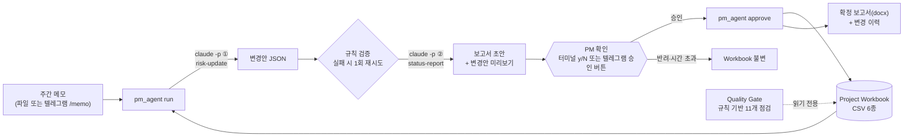

# PM AI Workflow

PM 표준 딜리버리 프로세스(수주 인수인계 → 착수 → 계획 → 수행·통제 → 인수·이관 → 종료)의 반복 업무를 AI 에이전트로 자동화한 개인 프로젝트입니다.
**Personal project, built outside the work network. 모든 데이터는 가상입니다.**

> **English summary** — A weekly PM loop automated with an AI agent: a status memo goes in (file or Telegram), the agent proposes validated changes to a CSV-based Project Workbook and drafts a status report, and **nothing is applied until a human approves** (terminal prompt or Telegram button). Every applied change is logged with its evidence. A rule-based Quality Gate checks the four process checkpoints. Python standard library + `python-docx`, driven by `claude -p`. All data is fictional.

## 문제

프로젝트 매니저는 매주 같은 일을 반복합니다. 업데이트 메모를 읽고, 리스크·이슈·액션 대장을 고치고, 마일스톤과 OKR 진척을 맞추고, 보고서를 쓰고, RAG 상태를 정합니다. 그리고 이 과정에서 놓치는 것이 생깁니다. 기한이 지난 액션, 담당자 없는 고위험 리스크, 계획 주차를 넘긴 마일스톤 리뷰 같은 것들입니다.

AI에게 맡기면 빨라지지만 새 문제가 생깁니다. 모델이 대장을 마음대로 고치면 아무도 믿을 수 없고, 무엇이 왜 바뀌었는지 추적할 수 없습니다.

## 설계 원칙

| 원칙 | 구현 |
|---|---|
| **AI는 제안만 하고 사람이 승인한다** | 변경은 JSON 변경안(diff)으로만 만들어지고, 사람이 승인하기 전에는 Workbook이 바뀌지 않습니다. 승인은 터미널 `y/N` 또는 텔레그램 버튼입니다. |
| **단일 기준 데이터** | 모든 항목은 Project Workbook(CSV 6종)에 있고 보고서·OKR 표·점검이 같은 데이터를 봅니다. |
| **AI 출력을 믿지 않고 검증한다** | 허용 값(`Open`/`Done` …), 키 존재, 중복 ID, OKR 문구 일치를 코드가 검사합니다. 거부되면 사유를 알려주고 한 번 다시 시킵니다. |
| **모든 변경에 근거를 남긴다** | 변경마다 메모의 근거 문장을 요구하고, 승인되면 변경 전후와 근거를 `history.csv`에 기록합니다. |
| **누락 점검은 AI가 아니라 규칙으로** | Quality Gate는 같은 입력에 항상 같은 결과를 내는 규칙 기반이고, 데이터가 없으면 통과가 아니라 `UNKNOWN`으로 표시합니다. |
| **규칙의 단일 기준은 스킬 파일** | AI에게 주는 규칙(RAG 판정 기준, 허용 값 등)은 `.claude/skills/*/SKILL.md`에만 있고 코드가 그대로 읽어 씁니다. |

## 동작 흐름



착수 단계도 같은 승인 경로를 씁니다. `intake`가 SOW에서 Handover 체크리스트·Charter·공동 OKR 표를 만들고, Workbook에 들어갈 마일스톤·초기 리스크는 변경안으로 만들어 같은 방식으로 승인합니다.

## 구성

| 구분 | 파일 | 역할 |
|---|---|---|
| 데이터 | [workbook.py](src/workbook.py) | CSV 읽기·쓰기, 변경안 검증·적용(전부 검증 후 반영), 이력 기록, Workbook 지문 |
| 오케스트레이터 | [pm_agent.py](src/pm_agent.py) | CLI(`run` `approve` `request` `intake` `listen` `quality`), `claude -p` 호출, 승인·확정 |
| 착수 | [intake.py](src/intake.py) | SOW → Handover 체크리스트·초기 리스크, Charter·공동 OKR 표 |
| 점검 | [quality_gate.py](src/quality_gate.py) | 4대 체크 이벤트 + 정기 점검 7개 |
| 텔레그램 | [telegram_io.py](src/telegram_io.py) · [approval_flow.py](src/approval_flow.py) · [memo_listener.py](src/memo_listener.py) | 봇 연결·본인 확인, 승인 버튼, 메모 입력 |
| 문서 | [md_to_docx.py](src/md_to_docx.py) | 보고서를 한글 서식의 Word 파일로 변환 |
| AI 규칙 | [.claude/skills/](.claude/skills/) | `status-report` `risk-update` `sow-intake` `charter-okr` |
| 시험 | [tests/](tests/) | 단위 테스트 170건(가짜 LLM·가짜 텔레그램 사용, 실제 호출 없음) |

## 실행 방법

필요한 것: Python(3.14에서 개발·테스트했고 3.10 이상이면 동작하도록 썼지만 다른 버전은 확인하지 않았습니다), [Claude Code](https://claude.com/claude-code) CLI(로그인 상태), `pip install -r requirements.txt`. 텔레그램은 선택입니다.

```powershell
# 주간 루프
python src/pm_agent.py run --week 5            # 메모 → 변경안·보고서 초안 (Workbook 불변, 약 4~5분)
python src/pm_agent.py approve --week 5        # 내용을 확인하고 y 를 입력하면 Workbook 반영·확정
python src/pm_agent.py quality --week 5        # Quality Gate 점검 (AI 호출 없음, 바로 실행됨)

# 착수 문서 (P0→P1)
python src/pm_agent.py intake                  # SOW → Handover 체크리스트·Charter·OKR 표 초안
python src/pm_agent.py approve --week 0

# 텔레그램 (선택): 먼저 .env 를 만든다 → Copy-Item env.example .env 후 봇 토큰 입력
python src/telegram_io.py check                # 연결 점검(토큰은 출력되지 않음)
python src/telegram_io.py setup                # 일회용 코드로 본인 확인 후 chat id 등록
python src/pm_agent.py listen --once           # 텔레그램 /memo 8 ... → 초안 → 승인 버튼 한 바퀴
python src/pm_agent.py run --week 6 --notify   # 초안 생성 후 텔레그램으로 승인 요청

# 시험
python -m unittest discover -s tests
```

**연습용 복사본**: 모든 명령에 `--root <폴더>`를 붙이면 그 폴더를 프로젝트 루트로 씁니다. 실제 Workbook을 건드리지 않고 시험해 볼 수 있습니다(`workbook/` `data/` `.claude/` 를 복사해 두세요).

텔레그램에서 메모를 보내는 형식:

```
/memo 8
- 웨이브1 리포트 16종 중 6종 전환 완료
- 레거시 스토어드 프로시저 고난도 3건 분석 시작
```

## 결과물 샘플

가상 프로젝트(레거시 DW → Databricks 마이그레이션, 16주)의 5~7주차와 착수 문서를 실제로 돌린 결과입니다. 승인된 확정본을 다듬지 않고 옮겼습니다. 다만 Handover 체크리스트의 M0 문구 두 줄은 PM이 마일스톤 상태를 `Done`으로 바꾸면서 직접 고쳤고, 그 사실이 문서 안에 적혀 있습니다.

| 샘플 | 내용 |
|---|---|
| [5주차 보고서](docs/samples/weekly_report_week05.md) · [7주차 보고서](docs/samples/weekly_report_week07.md) | RAG 상태, OKR 진척, 리스크·이슈, 결정 필요 사항 |
| [5주차 변경안](docs/samples/changeset_week05.json) | AI가 제안한 변경과 메모 근거(`reason`), PM이 볼 `notes` |
| [변경 이력](workbook/history.csv) | 승인된 모든 변경의 전후 값과 근거 |
| [Quality Gate 7주차](docs/samples/quality_gate_week07.md) | 4대 체크 이벤트와 정기 점검 결과 |
| [Handover 체크리스트](docs/samples/intake_handover_checklist.md) · [Charter](docs/samples/intake_charter.md) · [공동 OKR 표](docs/samples/intake_okr.md) | SOW에서 만든 착수 문서 |
| [현재 Workbook](workbook/) | 5~7주차와 착수 승인이 누적 반영된 상태 |

## 안전장치

- **승인 없이는 Workbook이 바뀌지 않습니다.** 변경 적용의 기본값이 미리보기(`dry_run`)입니다.
- **오래된 초안은 승인할 수 없습니다.** 초안을 만든 시점의 Workbook 지문이 다르면 거부하고, 이미 확정된 주차의 중복 승인과 반려된 초안의 승인도 막습니다.
- **일부만 반영되는 일이 없습니다.** 변경안 전체를 먼저 검증하고, 확정 문서는 임시 폴더에 만든 뒤 반영이 성공해야 확정합니다.
- **사람이 다 보지 못한 변경은 버튼으로 승인할 수 없습니다.** 텔레그램 요약에서 변경이 잘리거나 생략되면 버튼을 붙이지 않고 터미널 승인으로 돌립니다. 신규 항목은 확률·담당자 등 모든 값을 보여줍니다.
- **AI 호출은 도구 없이 합니다**(`claude -p --tools ""`). 입력 안의 지시문은 따르지 말고 자료로만 취급하도록 명시합니다.
- **CSV 수식 주입을 막습니다.** `=` `+` `-` `@`로 시작하는 값(숫자 제외)은 Excel에서 수식으로 실행될 수 있어 거부하고, 이력의 근거 문장은 앞에 `'`를 붙여 저장합니다. 게이트·단계 표기도 정확한 값(`G0`~`G5`, `P0`~`P5`)만 허용합니다.
- **텔레그램**: 등록된 chat id의 입력만 받고, 본인 확인은 일회용 코드로 합니다. 승인 버튼은 보낸 메시지와 변경안 해시에 묶여서 오래된 버튼이나 다른 주차의 버튼은 무시합니다. 토큰은 `.env`에만 두고 출력·로그·오류 메시지에서 제거합니다.
- **가상 데이터만 씁니다.** 텔레그램을 거치는 입력이므로 봇 도움말에도 안내가 있습니다.

## 한계

이 프로젝트가 **하지 못하는 것과 믿으면 안 되는 것**입니다.

- **AI 출력은 실행마다 달라집니다.** 같은 5주차 메모로 여러 번 돌렸을 때 액션 구성이 달랐습니다. 그래서 승인 단계가 선택이 아니라 필수입니다. 신규 리스크의 확률·영향은 추정이고, 메모에 없는 담당자는 지어내지 않고 `TBD`로 남기므로 사람이 채워야 합니다.
- **RAG 판정은 규칙을 주지만 최종 판단은 모델입니다.** 샘플 7주차 보고서가 일정 영역을 Red로 판정한 것은 규칙대로이긴 하지만 사람에 따라 Amber로 볼 수도 있습니다.
- **보고서 문구가 완벽하게 정리되지는 않습니다.** 샘플에 `R-신규`처럼 ID가 정해지기 전의 표기가 남아 있습니다. 확정 때 "승인 전" 같은 표시는 규칙으로 치환하지만, 모델이 표현을 바꾸면 치환하지 못하고 경고만 합니다.
- **검증은 가상 3주치로만 했습니다.** 실제 프로젝트 규모나 팀 협업에서의 검증은 없습니다. Workbook은 CSV라서 동시 편집이나 큰 데이터에는 맞지 않습니다.
- **느립니다.** 한 주차 초안에 `claude -p` 호출이 2번이라 약 4~5분 걸립니다. 그동안 텔레그램 봇은 응답하지 않습니다.
- **프롬프트 인젝션을 완전히 막지는 못합니다.** 도구 없는 호출, 출력 검증, 사람 승인으로 피해 범위를 줄인 것입니다.
- **텔레그램은 종단간 암호화가 아닙니다.** 그래서 가상 데이터만 보내도록 했습니다.
- **Quality Gate는 Workbook에 있는 데이터만 봅니다.** 회의 개최 여부처럼 데이터가 없는 항목은 확인하지 못하고, 2주 같은 기준값은 고정입니다.
- **설계만 하고 구현하지 않은 단계**: P2 웨이브 계획, P4 인수 체크리스트, P5 완료 보고. 기준 문서와 [설계 개념도](docs/PM_AI_Workflow_Concept.html)에 자동화 후보로만 있습니다.

## 폴더 구조

```
data/           가상 시나리오, 가상 SOW, 주간 업데이트 메모(입력)
workbook/       Project Workbook CSV(단일 기준 데이터) + history.csv(변경 이력)
src/            오케스트레이터와 도구 코드
.claude/skills/ 단계별 PM 스킬(AI 규칙)
tests/          단위 테스트와 고정 fixture
scripts/        시연용 복사본 만들기·변경 전후 보기(시연 영상 시나리오: docs/DEMO_SCRIPT.md)
docs/           기준 프로세스, 설계 개념도, 결과물 샘플, 시연 시나리오
outputs/        초안(drafts)·확정본(final)·점검 결과(quality). Git에는 올리지 않음
```

기준 프로세스는 [docs/PM_Delivery_Process_Integrated.md](docs/PM_Delivery_Process_Integrated.md), 작업 이력은 [PLAN.md](PLAN.md)에 있습니다.
